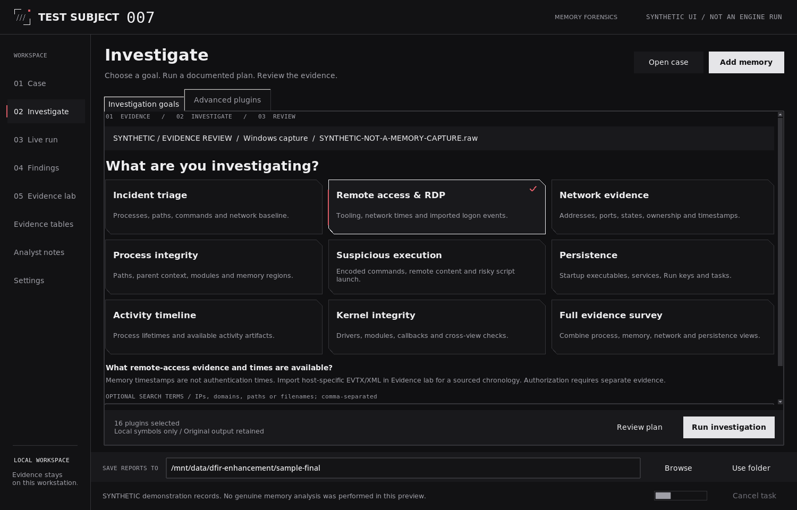

# Test Subject 007

## Memory forensics for Windows and Linux

Test Subject 007 is a local desktop application powered by Volatility 3. It helps analysts organize memory investigations, review source-linked evidence, examine collected executable hashes, and export PDF, HTML, and CSV reports.

**Workflow:** Add memory -> Choose an investigation -> Run -> Review evidence -> Export.

> Use only authorized evidence. Keep memory captures, case folders, acquired files, and reports outside this repository. Automated findings require analyst validation.



*The screenshot uses synthetic demonstration records. It is not evidence of a successful investigation of a real workstation.*

## Publish the complete project

Starting a new repository? Follow the [step-by-step GitHub guide](docs/GITHUB.md). This package contains the complete source, launchers, tests, documentation, and workflows. It is not a patch and requires no older application files.

Upload the visible contents first. Create the four hidden configuration files through GitHub's editor if your browser rejects hidden-file uploads; add `ci.yml` last. Never upload forensic evidence.

## 1. Before you start

Use a graphical Windows or Linux desktop and Python 3.10 or later. Windows requires a supported 64-bit Python installation with Tcl/Tk. The configured GitHub test matrix uses Python 3.11 and 3.12.

First-time installation needs access to your approved Python package sources. Memory analysis also requires a supported capture and matching symbols.

For a clean installation, download the **complete source**, not a changes-only archive. Extract it into a new folder and locate `pyproject.toml` before running commands. Do not copy an old `.venv` into the folder.

## 2. Install on Kali, Ubuntu, or Debian

### Step 1 - Install prerequisites

Open a terminal on your graphical desktop:

```bash
sudo apt update
sudo apt install -y python3 python3-venv python3-pip python3-tk
```

### Step 2 - Open the application folder

Open the extracted folder containing `pyproject.toml` and `RUN-LINUX.sh`, then open a terminal in that folder.

### Step 3 - Install and launch

```bash
bash RUN-LINUX.sh
```

The launcher creates the local environment when required, installs dependencies, and starts the interface after successful setup. Run it as your normal desktop account, **not with sudo**.

For Windows-symbol downloads approved by your investigation policy:

```bash
bash RUN-LINUX.sh --online-symbols
```

For later launches, use `bash RUN-LINUX.sh` again. The saved symbol policy is retained. Stop and review installation errors before proceeding; installer output is recorded in `.setup/install.log`.

## 3. Install on Windows

Install supported 64-bit Python with Tcl/Tk. Extract the complete source into a new folder, then double-click:

```text
RUN-WINDOWS.cmd
```

To permit approved Windows-symbol downloads, open PowerShell in that folder and run:

```powershell
.\RUN-WINDOWS.cmd --online-symbols
```

First launch prepares the environment when required. Later launches reuse it. Do not copy virtual environments between machines.

## 4. Run an investigation

1. **Add memory.** Select or paste the memory-image path, choose the captured operating system, and set separate case and report folders.
2. **Choose an investigation.** Select a goal and review the actual plugin plan. Advanced checkboxes and plugin-specific options remain available.
3. **Run and monitor.** Follow live output and task status. Resolve required options or explicitly accept reduced coverage; failed or deferred tasks remain visible.
4. **Review evidence.** Inspect actionable findings, background context, timestamps, and data-quality warnings. Use source references to examine the original records.
5. **Export.** Save a new PDF, HTML, and CSV report bundle. Use **LAST SAVED PATH**, **Copy path**, or **Open folder** to locate the output.

### Investigation goals

| Goal | Main purpose |
|---|---|
| Incident triage | Establish an initial process, command, network, and memory baseline. |
| Remote access & RDP | Review remote-administration artifacts and available session evidence. |
| Network evidence | Examine endpoints, states, ownership, timestamps, and supplied indicator matches. |
| Process integrity | Review executable paths, process relationships, modules, and memory candidates. |
| Suspicious execution | Examine concrete command and execution patterns rather than broad script keywords. |
| Persistence | Review selected Startup, service, registry, and task-related evidence. |
| Activity timeline | Compare process, network, and imported-event times without conflating them. |
| Kernel integrity | Review drivers, modules, callbacks, and selected cross-view discrepancies. |
| Full evidence survey | Collect a broader curated set of artifacts for analyst review. |

Actual coverage depends on the captured OS, installed plugins, symbols, and available memory. See [Investigation goals and scope](docs/INVESTIGATIONS.md).

## 5. Use the Evidence lab

**Processes & paths** provides process inventory and path-review context. **Collect selected PE** requests recovery of a selected Windows process executable when its bytes are recoverable.

**Files & SHA-256** records hashes of collected bytes. **Add acquired file** accepts a preserved file; any process association supplied by the analyst remains labelled accordingly. Original-file, reconstructed-PE, and other memory-artifact hashes remain distinct.

**Timeline & logons** imports supplied EVTX/XML records and preserves event provenance and timestamp meaning. This is not automatic event-log carving from RAM. Network-object creation, process creation, and authentication timestamps are not interchangeable.

**Analyst assessment** records a scoped conclusion with rationale and supporting references. The application does not establish authorization or operator identity from a process name, port, or IP address alone.

## 6. Understand the results

Normal environment settings, service descriptions, and event-log handles are not treated as script execution solely because they contain interpreter names or file extensions. Background context and suppression ledgers preserve those records without promoting them to actionable findings.

Suspicious paths and commands remain investigation leads. A supplied known-bad hash match retains its source; it is not an independent verdict. Digital signatures are **Not verified**. There is no public sample upload or online reputation lookup. Missing executable bytes mean no executable hash.

A completed workflow, empty finding list, or passing test suite does not establish that a workstation is clean. See [Validation and limitations](docs/VALIDATION.md) before operational use.

## 7. Update safely

Do not delete the repository or source folders before applying an update. A **changes-only** package requires the complete existing source. After deletion or an incomplete upload, restore the **complete source** on a review branch, check its files, and review automated validation before merging.

Preserve existing cases. Rebuild findings from saved evidence and export a new report; previous reports and original plugin output are not rewritten. New dependencies must be installed before using new features.

Follow the [safe update guide](docs/UPDATE-GITHUB.md).

## 8. Development checks

Run these from the repository root inside a development virtual environment.

Install development dependencies:

```bash
python -m pip install -e ".[analysis,dev]"
```

Linux headless GUI tests require Xvfb:

```bash
sudo apt install -y xvfb
xvfb-run -a python scripts/run_tests.py --require-all
```

Windows desktop tests:

```powershell
python scripts/run_tests.py --require-all
```

Keep `--require-all` in GitHub Actions. Review failures and skipped-check diagnostics rather than disabling tests. The source-file allowlist is `PUBLIC-FILES.txt`.

## Documentation

| Guide | Contents |
|---|---|
| [Installation and operation](docs/INSTALL-AND-USE.md) | Setup, diagnostics, existing cases, and operation. |
| [Investigation scope](docs/INVESTIGATIONS.md) | Goal selection and evidence limitations. |
| [DFIR capabilities](docs/DFIR-UPDATE.md) | Findings, hashes, timestamps, and interpretation. |
| [New GitHub repository](docs/GITHUB.md) | Upload the complete project, including hidden files, and check validation. |
| [Safe updates](docs/UPDATE-GITHUB.md) | Review branches and complete-source recovery. |
| [Validation](docs/VALIDATION.md) | Recorded tests and remaining acceptance checks. |
| [Hash-intelligence template](docs/hash-intelligence-template.csv) | Header for a source-attributed local intelligence list. |

## License and project status

This independent project is not an official Volatility Foundation product. Application licensing is described in [LICENSE](LICENSE); dependencies retain their own licenses in [THIRD_PARTY_NOTICES.md](THIRD_PARTY_NOTICES.md). Report security concerns according to [SECURITY.md](SECURITY.md).
